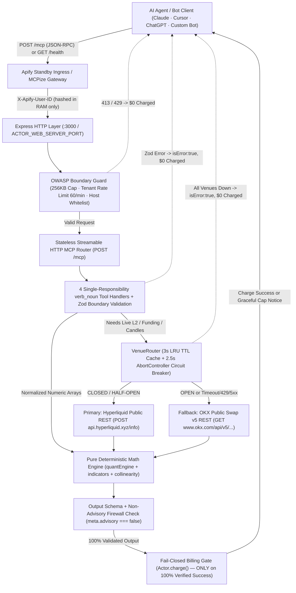

# 🏛️ QuantPreflight & Strategy-Audit MCP (`quant-preflight-mcp`) — Phase 0 Master Architectural Blueprint

**Version**: `1.1.0-approved`  
**Date**: `2026-11-25`  
**Status**: `Phase 0 Approved (Incorporating 4 Mandatory Governance Refinements)`  
**Governing Disciplines**: `Master Plan Architect` · `MCP Builder` · `Workflow Architect` · `API Tester` · `Pricing Analyst` · `Reality Checker`

### Mandatory Phase 0 Sign-Off Refinements
1. **Strict BillingGate Uncharged Result Suppression**: When `Actor.charge()` reports `eventChargeLimitReached === true`, if `chargedCount >= 1` (final paid unit succeeded), return full analytics + `billing_notice`. If `chargedCount === 0` (budget already exhausted, `$0` collected), **suppress all paid analytical output** and return a graceful structured notice (`"Free tier or max charge limit reached"`) without crashing. Both branches tested in `tests/mcpAndBilling.test.ts`.
2. **2-Tier TTL Cache Separation**: `LruTtlCache` enforces `3,000ms` TTL for real-time microstructure (`l2Book`, `metaAndAssetCtxs`, `funding`, `openInterest`) and `30,000ms` TTL for OHLCV `candleSnapshot` data.
3. **Symbol Normalization Mapper & Cloud Region Assumption Verification**: `VenueRouter.normalizeSymbol(rawSymbol, venue)` maps `BTC`, `BTCUSDT`, `BTC-PERP`, `kPEPE`/`1000PEPE`, etc. cleanly to Hyperliquid (`BTC`, `kPEPE`) and OKX Swap v5 (`BTC-USDT-SWAP`, `PEPE-USDT-SWAP` with `ctVal` contract-multiplier scaling). Because OKX AWS US/EU non-blocking on Apify Cloud IPs is an unverified external assumption until cloud deployment, `HANDOFF_DEPLOY_TRACK_B.md` mandates a post-push staging HTTP 200 verification check on both venues.
4. **Stateless MCP HTTP Method Guard (`405`)**: `GET /mcp` and `DELETE /mcp` explicitly return HTTP `405 Method Not Allowed` with a JSON-RPC error payload (`Allow: POST`) instead of Express default HTML 404.

---

## 1. 🎓 Conceptual Masterclass: Architecture Overview & Multi-Tenant Stateless Flow

### 1.1 The Core Problem & Strategic Pivot
Manual retail trading web calculators fail on human psychology, manual data-entry friction, and low AdSense RPM. Conversely, AI coding/trading agents (Claude Desktop, Cursor, ChatGPT, autonomous Python/TS execution bots) suffer from the exact opposite failure mode: **LLM Quantitative Hallucination**. Language models guess orderbook slippage, invent Kelly fractions without microstructure drag, stack 10 collinear momentum indicators ("1 feature wearing 10 masks"), and underestimate multi-hundred-trade losing streaks.

`quant-preflight-mcp` resolves this gap as a **100% Stateless, Zero-Proxy, Pay-Per-Event (PPE) Apify Standby Server Actor + MCPize-compatible Streamable HTTP Server**. It salvages the deterministic math kernel proven in `track-a-quant-workbench/src/lib/quantEngine.ts` (`clampFinite`, `mulberry32`, Kelly with friction, breakeven drag, position sizing, absorbing Markov streak DP) and pairs it with live L2 orderbook book-walking, Wilder ATR, Ridge-stabilized VIF + Modified Gram-Schmidt orthogonalization, and 5,000-path Monte Carlo ruin auditing.

### 1.2 Multi-Tenant Stateless Architecture Diagram

### 1.3 Why Stateless Per-Request MCP Transport + Zero Proxy Wins Unit Economics
- **Zero Session Bleed & Zero Idle Leak**: In `@modelcontextprotocol/sdk`, stateful SSE sessions hold per-client closures in RAM and leak memory when AI clients disconnect ungracefully. By instantiating `StreamableHTTPServerTransport({ sessionIdGenerator: undefined, enableJsonResponse: true })` per HTTP request while keeping only bounded LRU caches (`max: 200`, TTL `3,000ms`) and bounded rate-limit buckets in module scope, memory stays flat inside a `256MB–512MB` Apify container.
- **Contribution Margin Protection (`Pricing Analyst` Discipline)**:
  - **Direct COGS per call**: `$0.0000` residential proxy + `~$0.00002` Apify compute (`<50ms` CPU / `<400ms` standby I/O on 256MB–512MB) → **>99% gross compute margin** before platform revenue share.
  - **PPE Price Anchoring**: `$0.008`–`$0.025` per verified call vs. `$379/mo` institutional microstructure terminals. An Apify Free user (`$5.00` monthly credit) gets **200 to 625 free tool calls** out of the box, eliminating trial friction.

---

## 2. 🔍 Surgical Critique & Red Teaming (5 High-Risk Failure Vectors & Mitigations)

| # | Red-Team Failure Scenario | Root Cause in Naive Implementations | Mandatory Engineering Mitigation in `quant-preflight-mcp` |
| :--- | :--- | :--- | :--- |
| **RT-1** | **Cloud IP Geo-Block / HTTP 451 / 429 Storm** | Binance (`api.binance.com`) returns HTTP 451 and Bybit (`api.bybit.com`) triggers CloudFront HTTP 403 on AWS US/EU datacenter IPs used by Apify Standby. | **Primary**: Hyperliquid (`POST https://api.hyperliquid.xyz/info`, globally open JSON API). **Secondary Fallback**: OKX Public v5 Swap REST (`https://www.okx.com/api/v5/market/books`, `funding-rate`, `open-interest`, `candles`), which serves public market data globally without AWS US geo-blocks. Strict `2,500ms` `AbortController` + 3-strike `30s` OPEN circuit breaker. |
| **RT-2** | **Singular / Constant Indicator Matrix `NaN` Explosion** | User passes `sma_20` + `bb_middle` (exact linear duplicate, $\det(R)=0$) or flat volume column ($\sigma = 0$), causing $0/0 = \text{NaN}$ in Z-score, matrix inversion crash, or `Infinity` in JSON serialization. | 1) Pre-scan columns: any column with $\sigma < 10^{-12}$ is flagged in `dropped_constant_columns[]` and excluded before Z-scoring. 2) Ridge stabilization $(R + 10^{-10}I)^{-1}$ guarantees invertibility even under exact duplicate columns. 3) Symmetric Jacobi eigensolver caps Condition Number at $10^{12}$. 4) Two-pass Modified Gram-Schmidt ("twice is enough") guarantees `max_off_diagonal_dot < 1e-9` (`~1e-14` typical), with zero-norm residual columns zeroed safely instead of dividing by $0$. 5) Final recursive `assertNoNaNOrInfinity()` check before billing. |
| **RT-3** | **Thin / Exhausted L2 Orderbook on Large `order_size_usd`** | Agent requests `$5,000,000` market buy on a mid-cap perp whose top 20–50 book levels hold only `$420,000`, causing naive book-walkers to divide by zero or silently under-report notional. | Book-walker tracks `filled_usd`, `unfilled_usd`, and `max_available_book_usd`. When `filled_usd < order_size_usd`, it sets `insufficient_book_depth: true`, computes VWAP across available depth, appends an explicit `INSUFFICIENT_BOOK_DEPTH` warning, and never extrapolates fake liquidity. If book levels are empty (`levels.length === 0`), returns `isError: true` (`EMPTY_ORDERBOOK`) with **`$0` charge**. |
| **RT-4** | **Billing Leakage, Double-Charge, or Crash on `eventChargeLimitReached`** | Calling `Actor.charge()` at request entry charges users for 429s/timeouts; ignoring Apify's `eventChargeLimitReached` return flag causes unhandled loops or misleading errors on Free-tier caps. | **Single Choke-Point `BillingGate.chargeAfterSuccess(eventName)`**: Invoked *exclusively* after (a) upstream fetch, (b) deterministic math, (c) Zod output validation, and (d) Non-Advisory Firewall verification succeed, with a per-request `charged: boolean` idempotency guard preventing double-charging. If `result?.eventChargeLimitReached === true`, returns a graceful structured notice without crashing. |
| **RT-5** | **Standby Container Idle Memory Leak & Unbounded Maps** | Multi-tenant HTTP servers accumulate stale cache keys, per-IP/tenant rate-limit arrays, and lingering MCP transport listeners over hours of Standby uptime until OOM-killed (`137`). | 1) `LruTtlCache` enforces hard `maxEntries = 200` and evicts expired `3,000ms` entries on read/write. 2) `TenantRateLimiter` caps map size at `5,000` hashed tenant keys and prunes windows older than `60,000ms`. 3) Stateless per-request MCP transport closes on `res.on('close')`. |

### Anti-Scope Creep Filter (Strictly Forbidden in Track B)
- ❌ Zero HTML/CSS UI pages, charts, browser scripts, or databases.
- ❌ Zero 5th MCP tool (strictly frozen to the 4 specified `verb_noun` tools).
- ❌ Zero Apify Proxy / residential proxy usage.
- ❌ Zero raw orderbook/candle array passthrough (`bids[]`, `asks[]`, `candles[]` raw redistribution prohibited).
- ❌ Zero directional words (`BUY`, `SELL`, `HOLD`, `LONG`, `SHORT` recommendations) in generated advisory/verdict strings (note: echoing validated input `side: "buy" | "sell"` as `input_side` or neutral factual descriptions avoids advisory language; a dedicated regex firewall test enforces zero directional advice).

---

## 3. 🔄 Complete State Transition, Handoff & Failure Recovery Matrix (`Workflow Architect`)

### 3.1 Request Lifecycle State Table

| Scenario / Branch | Trigger Condition | Venue / Engine Action | HTTP Status | MCP Payload Returned | `Actor.charge()` Executed? | Log / Telemetry State |
| :--- | :--- | :--- | :---: | :--- | :---: | :--- |
| **1. Happy Path (Live or Cache Hit)** | Valid JSON-RPC + valid Zod input + venue data valid + output schema passes | Cache hit (`<3s`) OR Primary Hyperliquid responds `<2.5s` → Math → Output Zod check | `200 OK` | `{ content: [{ type: "text", text: JSON }], structuredContent }` with mandatory `meta` | **YES (1x exact PPE event)** | Masked tenant hash, latency ms, venue, event charged |
| **2. Payload Too Large** | `Content-Length > 256 KB` | Express body parser rejects immediately before JSON-RPC | `413` | JSON-RPC error `-32600` (`PAYLOAD_TOO_LARGE`) | **NO (`$0`)** | Warn log (size bytes, masked tenant) |
| **3. Tenant Rate Limit** | `> 60` requests / `60s` sliding window for hashed `X-Apify-User-ID` (or IP fallback) | Rejected at `TenantRateLimiter` middleware | `429` | JSON-RPC error `-32029` (`RATE_LIMIT_EXCEEDED`, `retry_after_ms`) | **NO (`$0`)** | Warn log (masked tenant hash) |
| **4. Input Validation Failure** | Missing required field, `NaN`, out-of-range `order_size_usd`, invalid Mode A/B in Tool 3 | Rejected at Zod input boundary before any network call | `200 OK` (MCP tool error) | `{ isError: true, content: [{ type: "text", text: "{\"error\":{\"code\":\"INVALID_INPUT\",...}}" }] }` | **NO (`$0`)** | Info log (tool name, validation field) |
| **5. Primary Timeout / 429 / 5xx → Fallback Success** | Hyperliquid exceeds `2,500ms` `AbortController` or returns `429`/`5xx` (3 strikes → Circuit `OPEN` for `30s`) | `VenueRouter` immediately routes request to Secondary (`OKX Swap v5`) | `200 OK` | Full valid tool JSON with `venue_used: "okx_fallback"` + warning note | **YES (1x exact PPE event)** | Warn log (`PRIMARY_DEGRADED`, circuit state) |
| **6. All Venues Down / Unlisted Symbol** | Both Primary and Fallback timeout, fail, or symbol does not exist on either venue | `VenueRouter` throws typed `UpstreamUnavailableError` / `SymbolNotFoundError` | `200 OK` (MCP tool error) | `{ isError: true, content: [{ type: "text", text: "{\"error\":{\"code\":\"UPSTREAM_UNAVAILABLE\",...}}" }] }` | **NO (`$0`)** | Error log (upstream status codes, `$0` billed) |
| **7a. Charge Cap Reached (`chargedCount >= 1`)** | Computation succeeded, `Actor.charge()` returns `{ eventChargeLimitReached: true, chargedCount: 1 }` | `BillingGate` delivers paid result + attaches `billing_notice` | `200 OK` | Full valid tool JSON + `billing_notice: "Free tier or max charge limit reached"` | **YES (Final allowed event)** | Info log (`CHARGE_LIMIT_REACHED_FINAL_PAID`) |
| **7b. Charge Cap Exhausted (`chargedCount === 0`)** | Computation succeeded, `Actor.charge()` returns `{ eventChargeLimitReached: true, chargedCount: 0 }` | `BillingGate` **blocks paid result leakage** and returns graceful cap notice | `200 OK` | `{ content: [{ type: "text", text: "{\"billing_status\":\"CHARGE_LIMIT_REACHED\",\"message\":\"Free tier or max charge limit reached\"...}" }] }` (No paid metrics leaked, `isError: false`, zero crash) | **NO (`0` units charged by platform)** | Warn log (`CHARGE_LIMIT_SUPPRESSED_RESULT`) |
| **9. Unsupported HTTP Method on `/mcp`** | Client sends `GET /mcp` or `DELETE /mcp` (SSE stream / session close probes) | Express method guard intercepts before route fallthrough | `405` | JSON-RPC error `{ jsonrpc: "2.0", error: { code: -32000, message: "Method Not Allowed..." }, id: null }` + `Allow: POST` | **NO (`$0`)** | Debug log (`MCP_METHOD_NOT_ALLOWED`) |
| **8. Apify Console Batch Run (Non-Standby Fallback)** | Actor started as standard one-shot job (`APIFY_META_ORIGIN` / Standby off, `Actor.getInput()` present) | Reads `tool` + `params` from `.actor/input_schema.json`, runs handler once, pushes to `Dataset.pushData()`, charges once on success | N/A (CLI/Batch exit `0`) | Saved to default Apify Dataset | **YES (1x on valid output; 0x on error)** | Standard Actor run summary |

### 3.2 External Handoff Contracts
- **Handoff A (`VenueRouter` → `HyperliquidAdapter`)**:
  - Endpoint: `POST https://api.hyperliquid.xyz/info` (Host whitelisted in `ALLOWED_UPSTREAM_HOSTS`).
  - Payloads: `{ type: "l2Book", coin }`, `{ type: "metaAndAssetCtxs" }`, `{ type: "candleSnapshot", req: { coin, interval, startTime, endTime } }`.
  - Timeout: `2,500ms` hard `AbortController`. Failure increments `hlFailures`; `>= 3` consecutive failures opens circuit for `30,000ms`.
- **Handoff B (`VenueRouter` → `OkxSwapAdapter`)**:
  - Endpoints: `GET https://www.okx.com/api/v5/market/books?instId={SYM}-USDT-SWAP&sz=50`, `/api/v5/market/candles`, `/api/v5/public/open-interest`, `/api/v5/public/funding-rate`, `/api/v5/market/tickers?instType=SWAP` (Host `www.okx.com` whitelisted).
  - Normalizes funding rate intervals (`8h` vs `1h`) into both `funding_rate_1h_pct`, `funding_rate_8h_pct`, and annualized `funding_apr_pct = rate_1h * 24 * 365`.
  - Timeout: `2,500ms` hard `AbortController`.

---

## 4. 🗺️ File Mutation Manifest (`track-b-quant-preflight-mcp/`)

Existing `track-a-quant-workbench/` remains **100% untouched (read-only reference for math salvage)**. Every new file resides strictly inside `track-b-quant-preflight-mcp/`:

| Action | File Path | Single Responsibility |
| :---: | :--- | :--- |
| `[NEW]` | `track-b-quant-preflight-mcp/00_TRACK_B_BLUEPRINT.md` | Phase 0 architectural contract, Red-Team mitigations, state tables, and verification spec. |
| `[NEW]` | `track-b-quant-preflight-mcp/package.json` | Node 22+ ESM package manifest (`apify`, `@modelcontextprotocol/sdk`, `zod`, `express`, `typescript`, `vitest`, `@types/express`, `@types/node`). |
| `[NEW]` | `track-b-quant-preflight-mcp/tsconfig.json` | Strict TypeScript configuration (`strict: true`, `noUncheckedIndexedAccess: true`, `NodeNext`). |
| `[NEW]` | `track-b-quant-preflight-mcp/vitest.config.ts` | Deterministic Vitest runner config with coverage and timeout thresholds. |
| `[NEW]` | `track-b-quant-preflight-mcp/Dockerfile` | Multi-stage `node:22-bookworm-slim` production image, `npm ci --omit=dev`, non-root `node` user. |
| `[NEW]` | `track-b-quant-preflight-mcp/.dockerignore` | Excludes `node_modules`, `tests`, `coverage`, `.git`, local artifacts from Docker build context. |
| `[NEW]` | `track-b-quant-preflight-mcp/.actor/actor.json` | Apify Standby Actor spec (`usesStandbyMode: true`, `webServerMcpPath: "/mcp"`). |
| `[NEW]` | `track-b-quant-preflight-mcp/.actor/pay_per_event.json` | Exact 4 PPE billing events (`$0.008`, `$0.010`, `$0.025`, `$0.025`). |
| `[NEW]` | `track-b-quant-preflight-mcp/.actor/input_schema.json` | Fallback Apify Console one-shot input schema supporting all 4 tools. |
| `[NEW]` | `track-b-quant-preflight-mcp/src/types/schemas.ts` | Mandatory `NonAdvisoryMetaSchema`, Zod input/output contracts for all 4 tools, and Non-Advisory Firewall validator. |
| `[NEW]` | `track-b-quant-preflight-mcp/src/engine/quantEngine.ts` | Salvaged pure math from Track A (`clampFinite`, `mulberry32`, Kelly, Breakeven, Sizing, Markov Streak DP) + L2 VWAP Book-Walker + 5,000-path Seeded Monte Carlo Reality Simulator. |
| `[NEW]` | `track-b-quant-preflight-mcp/src/engine/indicators.ts` | Wilder 14-period ATR, technical feature builders (`sma`, `ema`, `rsi_14`, `bb_upper`, `bb_lower`, `atr_14`, `volume_zscore`, `roc`), Ridge VIF, Jacobi SVD/Eigen Condition Number, and 2-pass Modified Gram-Schmidt orthogonalizer. |
| `[NEW]` | `track-b-quant-preflight-mcp/src/adapters/cacheAndBreaker.ts` | Bounded `LruTtlCache` (`3s` TTL, max `200` keys), `CircuitBreaker` (`2.5s` timeout, 3-strike `30s` OPEN), and SSRF host whitelist fetch wrapper. |
| `[NEW]` | `track-b-quant-preflight-mcp/src/adapters/hyperliquidAdapter.ts` | Primary Hyperliquid REST adapter (`l2Book`, `metaAndAssetCtxs`, `candleSnapshot`). |
| `[NEW]` | `track-b-quant-preflight-mcp/src/adapters/okxAdapter.ts` | Secondary OKX v5 Swap public REST fallback adapter normalized to `MarketVenueAdapter`. |
| `[NEW]` | `track-b-quant-preflight-mcp/src/adapters/venueRouter.ts` | Primary → Fallback orchestrator with cache lookup, freshness tracking, and structured `UPSTREAM_UNAVAILABLE` error normalization. |
| `[NEW]` | `track-b-quant-preflight-mcp/src/billing/billingGate.ts` | Fail-closed single choke-point `Actor.charge()` wrapper, `LOCAL_STANDALONE` test spy/stub support, and graceful `eventChargeLimitReached` handler. |
| `[NEW]` | `track-b-quant-preflight-mcp/src/security/rateLimiter.ts` | SHA-256 tenant ID masking (`X-Apify-User-ID` → 12-char non-reversible digest) + sliding-window `60 req/min` limiter. |
| `[NEW]` | `track-b-quant-preflight-mcp/src/mcp/tools.ts` | Registration & execution of `preflight_execution_risk`, `scan_venue_microstructure`, `audit_indicator_collinearity`, and `simulate_backtest_reality` with agent-optimized descriptions. |
| `[NEW]` | `track-b-quant-preflight-mcp/src/server.ts` | Express app (`GET /health`, `POST /mcp` Streamable HTTP Stateless MCP endpoint, `256KB` body cap, rate-limit middleware, PII-masked error handler). |
| `[NEW]` | `track-b-quant-preflight-mcp/src/main.ts` | Dual-mode entrypoint: Apify Standby HTTP server (`usesStandbyMode` / `LOCAL_STANDALONE=true`) + Apify Console one-shot `Actor.getInput()` batch mode. |
| `[NEW]` | `track-b-quant-preflight-mcp/tests/engine.test.ts` | 25+ deterministic math & boundary tests (NaN/Infinity, zero price, exhausted L2 book, constant column, collinear duplicate columns, MGS `<1e-9` orthogonality, 5,000-path MC determinism & `<50ms` SLA). |
| `[NEW]` | `track-b-quant-preflight-mcp/tests/mcpAndBilling.test.ts` | 20+ workflow, security & billing contract tests (2.5s timeout fallback, all-venues-down `0` charges, invalid input `0` charges, `eventChargeLimitReached` graceful handling, `meta.advisory === false`, zero `BUY/SELL` advice strings, `413` >256KB rejection, `429` rate limit, `/health` & `/mcp` E2E calls). |
| `[NEW]` | `track-b-quant-preflight-mcp/README.md` | 6-Fold high-conversion Apify Store & MCPize documentation (`$0.008` vs `$379/mo` anchoring, Claude/Cursor/ChatGPT JSON snippets, PPE table, math & SLA proofs). |
| `[NEW]` | `track-b-quant-preflight-mcp/HANDOFF_DEPLOY_TRACK_B.md` | Apify CLI push runbook, Console Standby + `minimalMaxTotalChargeUsd: 0.05` setup, MCPize mirror checklist, and 30/60/90-day Kill Criteria. |

---

## 5. 🧪 Verification Protocol, Performance SLAs & Instant Rollback Path

### 5.1 Reality-Checker Mandatory Gate (`NEEDS WORK` Until All 4 Proofs Pass)
1. **Static Type Safety**: `npx tsc --noEmit` → Exit code `0`, `0` errors.
2. **45+ Automated Edge-Case & Billing Tests**: `npx vitest run` → `100%` pass, explicitly asserting:
   - `chargeCallCount === 0` across every Zod error, upstream timeout, empty book, and all-venues-down test case.
   - `chargeCallCount === 1` on every valid tool execution.
   - `max_off_diagonal_dot < 1e-9` on Modified Gram-Schmidt even under near-singular matrices.
   - `meta.advisory === false` and regex prohibition of directional trading advice (`/\b(STRONG BUY|STRONG SELL|RECOMMEND BUY|RECOMMEND SELL|GO LONG|GO SHORT)\b/i` + standalone `BUY`/`SELL`/`HOLD` recommendation tokens).
3. **Local Standby HTTP & OWASP Smoke Test**:
   - Boot server with `LOCAL_STANDALONE=true` → `GET /health` returns `200` `{ status: "ok", mode: "multi-tenant" }`.
   - `POST /mcp` JSON-RPC `tools/list` returns exactly the 4 frozen tools.
   - `POST /mcp` JSON-RPC `tools/call` executes all 4 tools end-to-end (including live upstream L2/candles check when network is permitted, plus deterministic mocked latency/SLA verification).
   - `POST /mcp` with `>256KB` body returns HTTP `413`; `61st` rapid request from a test tenant header returns HTTP `429`.
4. **Latency SLAs**:
   - Pure CPU math (`audit_indicator_collinearity` Mode B & `simulate_backtest_reality` 5,000 paths): **`< 50 ms`**.
   - Warm 3s TTL cache hit MCP round-trip (`p95`): **`< 200 ms`**.
   - Live upstream L2 fetch MCP round-trip (`p95`, excluding external network outages): **`< 500 ms`**.

### 5.2 Rollback Strategy & Failure Containment
- **Workspace Isolation**: Because `track-b-quant-preflight-mcp/` is 100% isolated from `track-a-quant-workbench/`, rolling back Track B at any build stage is a zero-blast-radius directory removal or `git checkout` with zero impact on Track A or other workspace projects.
- **Production Apify Rollback**: Apify Actor builds use immutable version tags (`1.0.0`, `1.0.1`). If an upstream exchange changes its JSON schema in production:
  1. `VenueRouter` automatically fails over to the surviving venue (`Hyperliquid` ↔ `OKX`) within `2.5s`, and if both fail, **Fail-Closed Billing** ensures `$0.00` erroneous customer charges.
  2. In Apify Console → **Builds**, pin the `latest` tag back to the previous verified build number in `< 30 seconds`.
